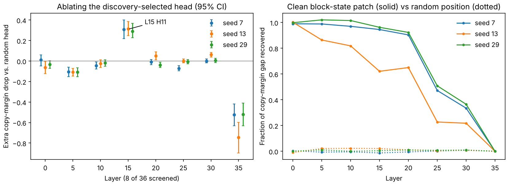

# Transformer Internals & Mechanistic Interpretability Lab

[](https://github.com/Idnotfound-L/transformer-interpretability-lab/actions/workflows/tests.yml)


**In short:** when a language model continues a repeated sequence (`… A B … A → B`), which of its internal components is it relying on? This project finds candidate attention heads and MLP neurons, then *causally* tests them by switching them off and by patching in activations from a clean run, with matched random controls, held-out prompts, and statistics, on GPT-2 and SmolLM3-3B.

The repository combines a PyTorch Transformer implementation, Hugging Face model instrumentation, a controlled sequence-copying study (Protocol V2), ablation and activation-patching experiments, statistical summaries, and an offline Streamlit dashboard.

**Models studied:** GPT-2 (`gpt2`) and SmolLM3-3B-Base (`HuggingFaceTB/SmolLM3-3B-Base`).

**Research question:** Which attention heads and MLP coordinates causally contribute to a controlled repeated-token sequence-copying behaviour, and how robust are these effects across independent seeds and model families?

## Key results



*Left: extra copy-margin drop from ablating each layer's discovery-selected head, relative to a matched random head in the same layer (SmolLM3-3B-Base, 3 seeds, 95% bootstrap CIs). Right: fraction of the copy-margin gap recovered by patching clean block states at the earlier successor token (solid) versus a random position (dotted). Layer-35 recovery is zero and is not treated as mechanistic evidence. Regenerate with `python scripts/make_figures.py`.*

| Model | Finding | Evidence (3 seeds, BH-adjusted within each run) |
|---|---|---|
| SmolLM3-3B-Base | **Layer 15, Head 11** is selected by discovery in every seed. Ablating it hurts copying more than a matched random head and has little effect on the control task. | Extra margin drop 0.29-0.31; copy-minus-control specificity +0.26 to +0.32; q < 0.001 in each seed |
| GPT-2 | **Layer 3, MLP neuron 1718** is selected in every seed and shows a positive selected-vs-random effect. | Extra margin drop 0.20-0.35; specificity +0.23 to +0.36; q < 0.001 in each seed |
| SmolLM3-3B-Base | Clean block-state patching at the earlier successor token recovers most of the copy-margin gap in early/middle layers; random positions recover ~0. | Component-specific head/neuron patches recover little, which is consistent with distributed computation but does not distinguish it from redundancy |

These are evidence of a causal contribution to a *synthetic* task, not a proven induction circuit. Baseline copying is partial (held-out accuracy about 0.44-0.46 for SmolLM3 and 0.44-0.54 for GPT-2), and inference is within-seed; no pooled test across seeds has been run. Full tables, caveats and negative results are in [`reports/FINAL_RESEARCH_REPORT.md`](reports/FINAL_RESEARCH_REPORT.md) and [`results/`](results/README.md).

## What the project implements

- **Architecture-aware Hugging Face backend:** GPT-2-style and Llama-like decoder stacks, eager attention inspection, model metadata and GQA-aware hooks.
- **Protocol V2 discovery:** final-query attention lift to the earlier successor token B; earlier-A attention is retained as a diagnostic. MLP coordinates are ranked by clean-versus-corrupted final-query activation sensitivity.
- **Causal ablation:** selected attention heads and MLP coordinates are compared against same-layer random heads and activity-matched random neurons on held-out copy prompts.
- **Task-specificity control:** the same components are evaluated on a repetition-free random-transition control task.
- **Activation patching:** clean block-state patches at the earlier successor position, random-position controls, and component-specific head/neuron patches. The trivial whole-block final-query patch is omitted.
- **Statistics:** per-prompt metrics, bootstrap confidence intervals, paired sign-flip tests and Benjamini-Hochberg adjusted q-values.
- **Dashboard:** saved Protocol V2 runs can be inspected without reloading model weights.
- **Reproducibility:** seed, model revision, hardware, precision, selected layers, prompt hashes and experiment settings are exported in JSON metadata.

## Repository layout

```
transformer-interpretability-lab/
├── src/interpretability_lab/     # model, hooks, experiment logic, Protocol V2
├── scripts/                      # training, research runners, V2 run indexer, figure script
│   └── windows/                  # optional .bat wrappers for Windows users
├── dashboard/                    # TinyGPT, Hugging Face and Protocol V2 dashboards
├── tests/                        # automated tests
├── data/                         # small prompt examples/documentation
├── docs/                         # architecture, protocol, reproducibility notes, figures, provenance
├── results/                      # raw Protocol V1 (exploratory) and V2 (corrected) run bundles
├── reports/                      # final research report
└── artifacts/                    # local experiment outputs (git-ignored by default)
```

## Setup

Python 3.10+ (3.11 recommended).

```
git clone https://github.com/Idnotfound-L/transformer-interpretability-lab.git
cd transformer-interpretability-lab
python -m venv .venv
source .venv/bin/activate        # Windows: .venv\Scripts\activate
python -m pip install --upgrade pip
pip install -r requirements.txt
pip install -r requirements-huggingface.txt   # for pretrained-model experiments
pip install -e .
pytest -q
```

Windows users can instead run `scripts\windows\setup_windows.bat` and `scripts\windows\setup_huggingface_windows.bat` (see [`scripts/windows/README.md`](scripts/windows/README.md)). Clone to a short path (e.g. `C:\src\`) to avoid Windows long-path installation issues.

The test suite has 28 tests, run in CI on every push. They exercise software components and synthetic model adapters; passing tests are not a substitute for empirical validation on pretrained checkpoints.

## Run Protocol V2

### GPT-2 on CPU or GPU

Windows quick runner (defaults to seed 7):

```powershell
scripts\windows\run_protocol_v2_gpt2_windows.bat 7
```

Run individual seeds directly on any OS:

```bash
python scripts/run_sequence_copy_study_v2.py \
  --model-id gpt2 --device auto --dtype auto \
  --discovery-cases 96 --evaluation-cases 128 --control-cases 128 \
  --patch-cases 12 --layers 8 --batch-size 2 --seed 7
```

Repeat with `--seed 13` and `--seed 29`. Keep each timestamped output folder. V2 writes to `artifacts/sequence_copy_v2/` by default and does not overwrite Protocol V1 outputs.

### SmolLM3-3B-Base on a cloud GPU

Use a CUDA GPU with sufficient memory (the reported runs used an NVIDIA T4 in BF16). Install Transformers 4.53+ and required Hugging Face packages without reinstalling a preconfigured CUDA PyTorch build:

```bash
pip install "transformers>=4.53.0,<5" accelerate safetensors sentencepiece pandas tabulate
```

Run one seed:

```bash
python scripts/run_sequence_copy_study_v2.py \
  --model-id HuggingFaceTB/SmolLM3-3B-Base \
  --revision d78a42f79198603e614095753484a04c10c2b940 \
  --device cuda --dtype auto \
  --discovery-cases 96 --evaluation-cases 128 --control-cases 128 \
  --patch-cases 12 --layers 8 --batch-size 1 --seed 7 \
  --output-dir /path/to/persistent/storage/smollm3_protocol_v2
```

Repeat for seeds 13 and 29, preserving the same model revision and protocol settings. On a T4, batch size 1 is the conservative setting; batch size 4 may reduce runtime if memory permits. Save outputs to persistent storage (Google Drive or download from Kaggle) before the runtime ends.

### Output files

Each Protocol V2 run folder should contain:

| File | Purpose |
|---|---|
| `RUN_REPORT.md` | Human-readable per-run report |
| `run_metadata.json` | Protocol, model, hardware, precision, seeds, hashes and settings |
| `sequence_copy_cases_v2.csv` | Exact discovery/evaluation/control prompts and token IDs |
| `discovery_attention_scores_v2.csv` / `discovery_attention_summary_v2.csv` | Successor-B attention scoring |
| `discovery_neuron_ranking_v2.csv` | Corruption-sensitive MLP neuron ranking |
| `component_candidates_v2.csv` | Discovery-selected components and matched controls |
| `heldout_baseline_metrics.csv` / `heldout_baseline_summary.csv` | Baseline task performance and uncertainty |
| `candidate_vs_random_controls.csv` | Selected-versus-random copy-task ablation effects |
| `control_candidate_vs_random.csv` | Same comparison on random-transition control |
| `copy_specificity_summary.csv` | Copy effect minus control effect |
| `activation_patching_per_prompt_v2.csv` / `activation_patching_summary_v2.csv` | Block-position and component-specific patching |

## Dashboard

After running experiments, launch the Protocol V2 offline dashboard:

```bash
streamlit run dashboard/protocol_v2_dashboard.py
```

On Windows, double-click `scripts\windows\run_protocol_v2_dashboard_windows.bat`. Set the dashboard run directory to the folder containing the timestamped run folders if it is not the default `artifacts/sequence_copy_v2`.

The dashboard reads saved CSV/JSON outputs only. It does not download model weights or rerun experiments.

## Cross-seed indexing

To index all Protocol V2 run folders under a directory:

```bash
python scripts/summarize_v2_runs.py artifacts/sequence_copy_v2
```

For SmolLM3, point the utility at the persistent parent directory containing all three seed folders. It writes `run_index.csv`, per-seed tables and a descriptive component-consistency table. The utility does not pool p-values or replace a prompt-level meta-analysis.

## Limitations

1. The probe is a synthetic sequence-copying task, not a natural-language benchmark.
2. SmolLM3's baseline performance is partial; negative copy margins and low target probability constrain mechanistic claims.
3. Attention weights are candidate-discovery signals, not functional proof.
4. Random-transition accuracy is at 0%, so the control may have a floor effect.
5. Only eight of 36 layers and one top candidate per layer were screened in the reported protocol.
6. Component-specific patching was weak, and the block-state patching set was small (12 prompts per seed).
7. Ablation can be off-manifold; no single component should be read as a complete circuit.
8. Cross-model layer/head indices are not directly comparable.
9. GPT-2 V2 runs used CPU/float32 and did not record a resolved model revision, so exact GPT-2 weights are not pinned.

## Further reading

- [`reports/FINAL_RESEARCH_REPORT.md`](reports/FINAL_RESEARCH_REPORT.md): full write-up, including negative results
- [`results/README.md`](results/README.md): what each results folder contains (V1 exploratory vs V2 corrected; never pool them)
- [`results/protocol_v2/smollm3/THREE_SEED_FINDINGS_AUTHOR_SUMMARY.md`](results/protocol_v2/smollm3/THREE_SEED_FINDINGS_AUTHOR_SUMMARY.md): consolidated SmolLM3 three-seed summary
- [`docs/`](docs/): architecture, experiment protocol, protocol changelog, reproducibility checklist
- [`docs/provenance/`](docs/provenance/): archive manifest, results inventory and SHA-256 checksums

## Citation

See [`CITATION.cff`](CITATION.cff); please include the exact commit and model/data configuration used.

## License

MIT, see [`LICENSE`](LICENSE).
